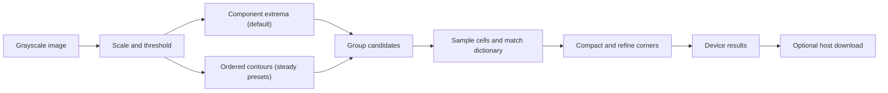

# Architecture

## Purpose

Describe how one frame moves through the detector and who owns its input,
workspace and results.

## Scope

The CUDA detector has a C++ API and a C ABI with a Python binding. The experimental
CPU detector and the OpenCV and Hybrid comparison tools are built separately from
the public API. Pose estimation belongs to the caller.

## Current state

The caller supplies a grayscale image in device or managed memory. Both GPU
extractors feed the same decoding and refinement stages.

Results contain marker IDs, rotations and corners in full-resolution coordinates.
The component extractor produces one quadrilateral per foreground component.
Ordered contours can recover individual marker borders that share a component.
[Pipeline design](design/detector-pipeline.md) · [Original extractor decision](adr/0003-candidate-extraction-approach.md) · [Steady extractor decision](adr/0004-device-contours-for-cpu-quality.md)

### Module boundaries

| Module | Responsibility |
| --- | --- |
| `src/core/`, `src/dictionary/` | GPU detector, workspace, packed codewords and matching. Public C++ declarations live in [include/aruco3cuda](../include/aruco3cuda). |
| `src/capi/`, `python/` | C ABI and its Python ctypes binding. [Interface design](design/c-abi-and-python.md) |
| `cpu/` | Experimental host-only detector using OpenCV. [CPU design](design/cpu-optimization.md) |
| `reference/`, `hybrid/` | Official OpenCV CPU baseline and a comparison route with GPU preprocessing and host contour extraction and decoding. |
| `bench/`, `tools/`, `test/` | Measurement, corpus generation, accuracy evaluation and regression tests. [Evaluation plan](evaluation-plan.md) |

### Ownership and synchronization

- The caller owns the image and stream. Input must remain valid until GPU reads
  complete. One detector instance serves one caller at a time.
- The detector owns the dictionary copy, reusable workspace and bounded output
  buffers. Device results are borrowed. Order downstream reads before another
  submission can overwrite them. Check the failure word and counts before consuming results.
- On an explicit stream, a stable input layout and address allow CUDA Graph replay.
  The detector records completion and orders reuse across streams. Host readback,
  layout changes and reinitialization have their own synchronization points.
  [Lifetime contract](../src/core/detector.md) · [C++ API](design/public-api.md)

## Goals

Keep intermediate images and detection results on the GPU. Use the same algorithm
on DGX Spark and Jetson Orin, with explicit build options for differences such as
resize arithmetic. [Strategy options](../cmake/ArUco3CudaStrategies.md) · [Hardware and toolchains](adr/0002-toolchain-and-target-baseline.md)

## Open questions

The OpenCV type adapter remains a design proposal. The [public API design](design/public-api.md#opencv-adapter)
describes the ownership question for dictionaries constructed at runtime.
